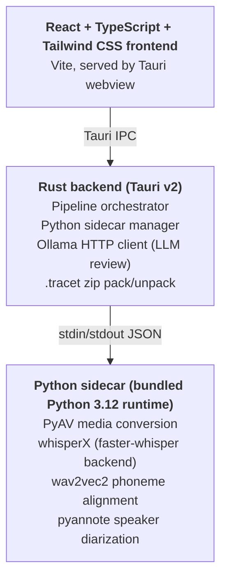

# Tracet

A local desktop app for transcribing audio and video, with speaker
identification, word-level confidence scoring, and an editable transcript.
Everything runs on your machine: no cloud APIs.

## Features

- **High-quality transcription** with whisperX (faster-whisper + phoneme
  alignment + integrated speaker diarization)
- **Speaker identification** via pyannote: give each detected voice a custom
  name once and it propagates through the transcript and exports
- **Word-level confidence highlighting**: three-tier visual scale (yellow →
  red dashed underline) makes likely errors easy to spot
- **Per-segment audio playback**: click ▶ on any line to hear the original
  audio for that exact segment
- **Inline editing**: click any text to fix it, edits persist and appear in
  exports
- **Hardware-aware model selection**: settings detect your chip and RAM, then
  filter Whisper and Ollama model options to what your machine can actually run
- **Optional LLM accuracy review** via Ollama (any local model)
- **`.tracet` project bundles**: save a zip containing the converted audio
  + transcript so you can transcribe on a powerful machine and edit elsewhere
- **Three export formats**:
  - **Markdown** (`.md`): prose for humans
  - **Plain text** (`.txt`): minimal
  - **AI-friendly Markdown** (`.ai.md`): YAML frontmatter with metadata,
    numbered segments, structured-but-readable; designed to hand off to any
    LLM without committing to a specific downstream task

## Architecture



## Requirements

- A Mac with Apple Silicon (M1 or later), macOS 11 or later
- About 1.3 GB of disk for the app, plus room for the speech model it
  downloads on first use (about 1.6 GB for the default `large-v3-turbo`)
- An internet connection the first time each speech model is used
- Optional: Ollama (https://ollama.ai) for LLM-based accuracy review

Intel Macs are not supported from 0.2.0 on: PyTorch no longer publishes
Intel macOS builds, and the transcription stack needs a current one.

Nothing else needs installing. The app carries its own Python runtime,
media decoder and speaker diarization model.

## Installation

### From a release DMG

Download `Tracet_<version>_aarch64.dmg` from the
[latest GitHub release](https://github.com/theagitist/tracet/releases/latest),
open it, and drag the app to Applications. The app is signed and notarized,
so Gatekeeper opens it without the "unidentified developer" warning.

There is no setup step. The first transcription downloads the speech model
once, with a progress bar; after that Tracet works offline.

### From source

```bash
git clone git@github.com:theagitist/tracet.git
cd tracet
HF_TOKEN_FILE=~/path/to/hf-token ./build.sh
```

`build.sh` builds the app, then `scripts/build-runtime.sh` assembles the
bundled runtime: a pinned standalone Python 3.12 with the exact package
versions in `sidecar/requirements.lock`, plus the diarization model. The
model's HuggingFace repo is gated, so this one build step needs a read token
from an account that has accepted the
[model's conditions](https://huggingface.co/pyannote/speaker-diarization-community-1);
pass it as `HF_TOKEN` or `HF_TOKEN_FILE`. Both downloads are cached in
`~/Library/Caches/tracet-build/`. Without a `signing.env`, the result is an
unsigned app in `src-tauri/target/aarch64-apple-darwin/release/bundle/macos/`.
A bare `cargo tauri build` produces an app without the runtime, which will
not transcribe.

## Development

```bash
./dev.sh
```

`dev.sh` finds the latest installed Node (working around the broken nvm
lazy-load shim some setups have), installs npm deps if missing, then runs
`cargo tauri dev` with hot reload.

Debug builds run the sidecar from the repo's `sidecar/` with a dev venv
(`sidecar/.venv`, Python 3.10 to 3.13, from `sidecar/requirements.txt`; the
in-app setup screen can create it). They use the bundled diarization model
from `src-tauri/target/runtime/models/` once `scripts/build-runtime.sh` has
run.

## Settings

Speaker diarization works out of the box: the pyannote model ships inside
the app, so no HuggingFace account or token is needed.

For LLM-based review, install Ollama and pull a model:

```bash
brew install ollama
ollama pull llama3.1:8b
```

Then enable LLM review in Settings.

## Privacy

Tracet is privacy-first by design. Audio files, transcripts, and saved
`.tracet` projects never leave your machine for normal use. There is no
telemetry, no analytics, no crash reporting, and no auto-updater. The
app does not phone home.

There are exactly two places where the app makes network requests:

1. **Whisper model download on first run.** The speech recognition and
   word-alignment weights are downloaded from HuggingFace and the Torch Hub
   the first time you transcribe. These are one-way downloads (no audio or
   transcript data is sent, and no account or token is used), and once
   cached, transcription works fully offline. The speaker diarization model
   ships inside the app, so it needs no download at all.
2. **Ollama LLM review (optional, local by default).** When LLM review is
   enabled, transcript text is sent to whatever URL the **Ollama URL**
   setting points at. The default is `http://localhost:11434`, so the
   data stays on this machine. If you change that URL to a non-local
   host (anything other than `localhost`, `127.0.0.1`, `::1`, or
   `0.0.0.0`), every transcript segment Tracet reviews will be sent in
   plaintext to that host. Settings detects this case, shows a red
   warning, and requires you to type `I understand` to apply the change.
   Keep the URL on `localhost` to preserve the privacy guarantee.

Things that explicitly do NOT happen:

- No transcript, audio, or project data is ever sent to a server Tracet
  controls. There is no Tracet backend.
- No analytics SDKs (Sentry, PostHog, Mixpanel, Amplitude, Google
  Analytics, Segment, etc.) are bundled.
- The Tauri auto-updater is not registered. You update by downloading a
  new release manually.
- The webview only loads bundled local assets; no third-party scripts
  are fetched at runtime.

If you want to verify any of this, the only outbound HTTP code paths
are `src-tauri/src/commands/setup.rs` (Ollama health check), and
`src-tauri/src/commands/review.rs` (Ollama generate call); plus the
model downloads inside the Python sidecar (`sidecar/diarize.py`, through
faster-whisper and whisperX).

## Project layout

```
.
├── build.sh                     # Signed + notarized release build
├── dev.sh                       # Dev launcher
├── index.html                   # Vite entry HTML
├── package.json                 # Frontend deps + scripts
├── src/                         # React + TypeScript frontend
│   ├── App.tsx
│   ├── components/              # Toolbar, TranscriptViewer, etc.
│   ├── hooks/                   # useTranscription, useSegmentPlayer, ...
│   ├── stores/                  # Zustand transcript store
│   ├── lib/                     # Settings persistence
│   └── types/                   # TypeScript mirrors of Rust structs
├── src-tauri/                   # Rust backend
│   ├── Cargo.toml
│   ├── tauri.conf.json
│   ├── capabilities/            # Tauri ACL
│   └── src/
│       ├── lib.rs               # Command registration
│       ├── commands/            # Tauri commands (one file per concern)
│       ├── pipeline/            # End-to-end orchestrator
│       ├── models/              # Transcript / Speaker / config structs
│       └── sidecar/             # Locates the bundled (or dev) Python
├── scripts/
│   └── build-runtime.sh         # Bundled Python runtime + diarization model
├── sidecar/                     # Python sidecar
│   ├── diarize.py               # whisperX entry point
│   ├── convert.py               # Any media to 16 kHz mono WAV (PyAV)
│   ├── audio_io.py              # Shared decoding helpers
│   ├── requirements.txt         # Dev venv
│   └── requirements.lock        # Exact versions shipped in releases
└── test-audio/                  # Generated test files for QA
    ├── short-single.wav         # 4.7s, single voice
    ├── short-multi.wav          # 12.7s, two voices alternating
    └── troublesome.wav          # 16.8s, designed to stress whisperX
```

## Acknowledgments

Tracet wires together excellent open-source work:

- [whisperX](https://github.com/m-bain/whisperX): transcription + alignment
- [pyannote-audio](https://github.com/pyannote/pyannote-audio): speaker
  diarization
- [pyannote/speaker-diarization-community-1](https://huggingface.co/pyannote/speaker-diarization-community-1)
  by pyannoteAI: the speaker diarization model, redistributed unmodified
  inside the app under
  [CC BY 4.0](https://creativecommons.org/licenses/by/4.0/)
- [faster-whisper](https://github.com/SYSTRAN/faster-whisper): CTranslate2
  Whisper backend
- [Ollama](https://ollama.ai): local LLM runtime
- [Tauri](https://tauri.app): desktop shell
- [PyAV](https://github.com/PyAV-Org/PyAV) and [FFmpeg](https://ffmpeg.org):
  media decoding

## License

MIT. See [LICENSE](LICENSE).
